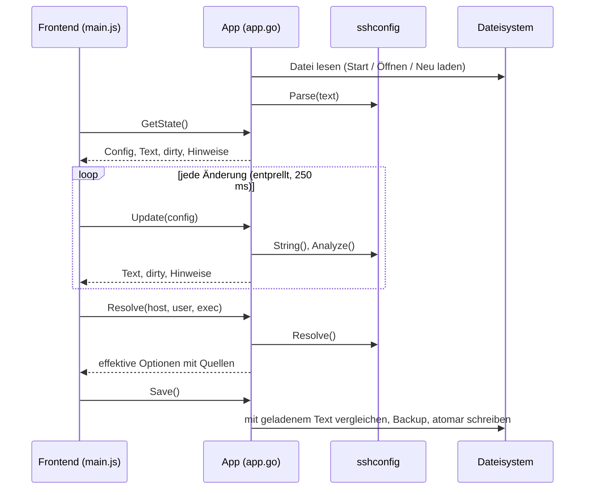

# Architektur

GoSSHpher ist eine [Wails-v2](https://wails.io)-Anwendung: ein Go-Prozess, dem die Datei und die gesamte ssh-Logik gehören, und ein Web-Frontend, das die WebView des Betriebssystems darstellt. Dieses Dokument beschreibt die Komponenten, den Datenfluss und die Regeln für das Lesen und Schreiben der Datei.

## Komponenten

| Teil              | Pfad                                                                                                                   | Aufgabe                                                                                                                                                                         |
| ----------------- | ---------------------------------------------------------------------------------------------------------------------- | ------------------------------------------------------------------------------------------------------------------------------------------------------------------------------- |
| Einstiegspunkt    | [main.go](../../main.go)                                                                                               | Wählt die Datei (erstes Kommandozeilenargument oder `~/.ssh/config`), bettet `frontend/dist` und das Linux-Fenster-Icon ein, startet das Wails-Fenster (1400×900, min. 900×600) |
| Gebundene API     | [app.go](../../app.go)                                                                                                 | Struct `App`, dessen exportierte Methoden aus JavaScript aufrufbar sind: Laden, Aktualisieren, Text einlesen, Auswerten, Änderungsvorschau, Speichern, Datei-Dialoge            |
| Einstellungen     | [settings.go](../../settings.go)                                                                                       | Einstellungsdatei im Konfigurationsverzeichnis des Benutzers: Backup-Optionen und Ansichtseinstellungen                                                                         |
| Extern            | [external.go](../../external.go)                                                                                       | Eingebundene Dateien, zweites Fenster, Ausführen von `Match exec`                                                                                                               |
| Übersetzungen     | [internal/i18n/](../../internal/i18n/)                                                                                 | Übersetzungskataloge `locales/<sprache>.json` (eingebettet), Abfrage mit Englisch als Fallback                                                                                  |
| Kernbibliothek    | [internal/sshconfig/](../../internal/sshconfig/)                                                                       | Parser, Writer, Auswertung, Prüfungen, Gruppen, Vergleich effektiver Werte, Keyword-Liste                                                                                       |
| Frontend          | [frontend/index.html](../../frontend/index.html), [frontend/src/](../../frontend/src/) (ES-Module, Einstieg `main.js`) | Oberfläche in Vanilla JavaScript, gebaut mit Vite 7                                                                                                                             |
| Erzeugte Bindings | [frontend/wailsjs/](../../frontend/wailsjs/)                                                                           | JS/TS-Wrapper für die `App`-Methoden, erzeugt von `wails build` / `wails generate module`                                                                                       |
| Plattform-Dateien | [build/](../../build/)                                                                                                 | Icons, macOS-`Info.plist`, Windows-Manifest/-Installer, Linux-`.desktop`-Datei                                                                                                  |

### Kernbibliothek (`internal/sshconfig`)

| Datei                                               | Inhalt                                                                                                                                                   |
| --------------------------------------------------- | -------------------------------------------------------------------------------------------------------------------------------------------------------- |
| [model.go](../../internal/sshconfig/model.go)       | Datenmodell: `Config` → `Block` (Art `global`, `host`, `match`) → `Entry` (`option`, `comment`, `blank`)                                                 |
| [parse.go](../../internal/sshconfig/parse.go)       | Zerlegt die Datei in Blöcke, behält jede Originalzeile in `Raw`, trennt Argumente wie ssh (Anführungszeichen, `#`-Kommentare am Zeilenende)              |
| [write.go](../../internal/sshconfig/write.go)       | Erzeugt den Text; unveränderte Zeilen kommen aus `Raw`, geänderte im Einrückungsstil des Blocks; fügt Gruppen-Marker ein                                 |
| [group.go](../../internal/sshconfig/group.go)       | Erkennen der Gruppen-Marker (`# [Name] start/end`), Prüfung der Namen                                                                                    |
| [match.go](../../internal/sshconfig/match.go)       | ssh-Wildcards (`*`, `?`), Negation, Kommalisten für `Match`                                                                                              |
| [resolve.go](../../internal/sshconfig/resolve.go)   | Auswertung wie ssh: erster Wert gewinnt, kumulative Keywords, `Match` (inkl. angenommener `exec`-Ergebnisse), `Include`                                  |
| [tokens.go](../../internal/sshconfig/tokens.go)     | %-Tokens, `${ENV}` und `~` je Keyword (TOKENS in `ssh_config(5)`)                                                                                        |
| [analyze.go](../../internal/sshconfig/analyze.go)   | Prüfungen, aus denen die Hinweise in der Oberfläche entstehen                                                                                            |
| [diff.go](../../internal/sshconfig/diff.go)         | Vergleicht die effektive Konfiguration aller festen Aliase zwischen zwei Versionen                                                                       |
| [keywords.go](../../internal/sshconfig/keywords.go) | Keywords aus `ssh_config(5)` mit Kennzeichen „kumulativ“ und typischen Werten; veraltete Aliase (die Beschreibungen stehen in den Übersetzungskatalogen) |

## Datenfluss



- **Während der Bearbeitung gehört das Dokument dem Frontend.** Es ändert seine Kopie der Config und schickt die ganze Struktur an `Update`. Go behält die neueste Version, erzeugt daraus den Text und gibt Text, Dirty-Kennzeichen und Hinweise zurück. Das Frontend ersetzt seine Kopie nicht durch die zurückgegebene, damit Eingabefelder mit Fokus beim Tippen nicht neu gezeichnet werden.
- **Dirty** bedeutet: erzeugter Text ≠ von der Platte gelesener Text.
- Die **Textansicht** schickt den Rohtext an `ParseText`; das Ergebnis ersetzt die Kopie im Frontend.
- **Effektive Konfiguration** (`Resolve`) und **Änderungsvorschau** (`PreviewChanges`) laufen immer in Go auf dem zuletzt synchronisierten Dokument.

## Gebundene Methoden

| Methode                                                                   | Zweck                                                                                                    |
| ------------------------------------------------------------------------- | -------------------------------------------------------------------------------------------------------- |
| `GetState()`                                                              | Aktueller Pfad, Config, erzeugter Text, Dirty-Kennzeichen, Hinweise                                      |
| `Update(cfg)`                                                             | Dokument durch die bearbeitete Version ersetzen                                                          |
| `ParseText(text)`                                                         | Dokument durch eingelesenen Rohtext ersetzen (behält CRLF, wenn die Datei es verwendete)                 |
| `Resolve(host, user, exec)`                                               | Effektive Konfiguration für einen Host, optional mit `-l`-User und angenommenen `Match exec`-Ergebnissen |
| `IncludeFiles(value)` / `OpenWindow(path)`                                | Dateien einer `Include`-Zeile / Datei in neuem Fenster öffnen (zweiter Prozess)                          |
| `RunMatchExec(host, user, command)`                                       | Einen `Match exec`-Befehl dieses Hosts in der Shell des Benutzers ausführen (Zeitlimit 10 s)             |
| `PreviewChanges(cfg)`                                                     | Effektive Werte, die sich zwischen aktuellem Dokument und `cfg` unterscheiden                            |
| `Keywords()`                                                              | Keyword-Liste für die Autovervollständigung                                                              |
| `Languages()` / `Translations(lang)`                                      | Verfügbare Sprachen / alle Texte einer Sprache                                                           |
| `NewID()`                                                                 | Zufällige Block-ID                                                                                       |
| `Save()` / `SaveForce()` / `SaveAs()`                                     | Datei schreiben (siehe unten)                                                                            |
| `Open()` / `Reload()`                                                     | Andere Datei laden / Änderungen verwerfen                                                                |
| `GetSettings()` / `SaveSettings(language, backup)` / `SaveUISettings(ui)` | Einstellungen lesen, Sprache und Backup-Optionen speichern, Ansichtseinstellungen speichern              |

## Regeln für Lesen und Schreiben

### Round Trip

- Jede Zeile wird als `Raw` aufbewahrt. Beim Schreiben wird eine Zeile unverändert ausgegeben, solange ihre geparste Form noch den strukturierten Feldern entspricht (`Key`/`Value`, Kommentartext, Muster der Kopfzeile). Nur bearbeitete Zeilen werden neu erzeugt, mit der Einrückung der ersten Optionszeile des Blocks (Standard zwei Leerzeichen, im globalen Block keine).
- Kommentare direkt über einer `Host`-/`Match`-Zeile gehören samt den trennenden Leerzeilen davor zu diesem Block (`Leading`) und wandern mit ihm. Kommentare weiter oben, durch eine Leerzeile getrennt, bleiben beim vorherigen Block; am Dateianfang bilden sie den Dateikopf (in der Host-Liste als *Dateikopf*).
- CRLF-Zeilenenden und ein fehlender abschließender Zeilenumbruch bleiben erhalten.
- Tests prüfen, dass Einlesen und Ausgeben für die Testdaten, `config.example` und eine lokale `config.template` (falls vorhanden) identische Bytes ergibt.

### Gruppen

Gruppen haben eine Ebene und werden als Kommentare gespeichert, die ssh ignoriert:

```
# [GitHub] start
Host github.com github-work github-private
  ...
# [GitHub] end
```

- Beim Lesen werden die Marker aus den Kommentaren entfernt und zu `Block.Group`. Die originalen Markerzeilen und ihre Position (`GroupStartRaw`/`GroupStartPos`, `GroupEndRaw`/`GroupEndTrail`) bleiben erhalten, damit auch von Hand formatierte Marker byteweise unverändert bleiben.
- Beim Schreiben entsteht ein Start-Marker dort, wo sich die Gruppe eines Blocks von der des vorherigen unterscheidet, und ein End-Marker dort, wo sie sich von der des nächsten unterscheidet. Neue Start-Marker stehen nach den führenden Leerzeilen, neue End-Marker direkt nach der letzten Option.
- Syntax der Marker: `#`, optionale Leerzeichen, `[Name]`, `start` oder `end` (Groß-/Kleinschreibung egal). End-Marker passen unabhängig von der Groß-/Kleinschreibung zu ihrer Gruppe.
- Ein End-Marker ohne offene Gruppe bleibt ein gewöhnlicher Kommentar. Eine Gruppe, die beim nächsten Start-Marker oder am Dateiende noch offen ist, wird beim Schreiben geschlossen.
- Eine Gruppe muss ein zusammenhängender Abschnitt von Blöcken sein. Das Frontend stellt das bei allen Aktionen sicher (siehe [Bedienung](usage.md#gruppen)).
- Gruppennamen dürfen nicht leer sein, kein `[`, `]` und keinen Zeilenumbruch enthalten, höchstens 80 Zeichen lang und müssen eindeutig sein (ohne Unterscheidung der Groß-/Kleinschreibung). Doppelte Namen in von Hand bearbeiteten Dateien ergeben eine Warnung.

### Auswertung (`Resolve`)

- Der Host wird vor dem Vergleich klein geschrieben (wie bei ssh). Host-Muster passen, wenn mindestens ein positives Muster passt und kein negiertes.
- Pro Keyword gewinnt der erste Wert (Aliase wie `PubkeyAcceptedKeyTypes` teilen sich den Platz mit ihrem aktuellen Namen). Kumulative Keywords sammeln Werte; wiederholte identische `IdentityFile`-/`CertificateFile`-Werte werden wie bei ssh ignoriert.
- `Match`-Kriterien: `all`, `host`, `originalhost`, `user`, `localuser`, `tagged` werden ausgewertet; `final` gilt als zutreffend; `canonical` wird nicht simuliert (unzutreffend); `localnetwork`, `version`, `sessiontype`, `command` lassen sich offline nicht auswerten und gelten als nicht zutreffend (im Ergebnis vermerkt).
- `Match exec` wird bei der Auswertung nie ausgeführt: Der Befehl wird mit %-Tokens aufgelöst und in den Annahmen der Oberfläche nachgeschlagen (Standard: fehlgeschlagen); `!exec` negiert wie bei ssh. Wie ssh überspringt die Auswertung `exec`, sobald ein vorheriges Kriterium der Zeile nicht zutrifft. Jedes erreichte `exec` wird gemeldet (`BlockResult.Execs`). `RunMatchExec` führt nur Befehle aus, die in der Auswertung des angegebenen Hosts vorkommen.
- `Include` wird verfolgt, wenn sein Block zutrifft: Globs, `~/`, Pfade relativ zum Verzeichnis der bearbeiteten Datei, maximale Tiefe 16. Eingebundene Dateien werden nur gelesen.
- %-Tokens: `Hostname` kennt `%h`; für Keywords mit Tokens liefert die Auswertung zusätzlich die aufgelösten Werte (`ResolvedOption.Expanded`) mit `%C %d %h %i %j %k %L %l %n %p %r %u %%` (und `%T` bei `LocalCommand`, nur `%h %n %p %r` bei `ProxyCommand`/`ProxyJump`), `${ENV}` und `~/`, wo ssh sie unterstützt. `%C` ist der SHA-1 von `%l%h%p%r%j`. Tests vergleichen `ControlPath`, `RemoteCommand` und `UserKnownHostsFile` mit `ssh -G`.
- Die Prüfung der Schlüsseldateien ersetzt Tokens je festem Alias eines `Host`-Blocks (`IdentityFile ~/.ssh/%h`).
- Ein Test vergleicht das Ergebnis für jeden festen Alias der Testdaten und von `config.example` mit `ssh -G`.

### Prüfungen (`Analyze`)

Hinweise und Notizen der Auswertung sind sprachneutral: Jeder hat einen Code und Parameter (z. B. `shadowed` mit `key`, `value`, `hint` und einem Eintrag pro betroffenem Alias). Die Oberfläche macht daraus mit den Katalog-Schlüsseln `issue.<code>` und `note.<code>` Text.

| Schweregrad | Prüfung                                                                                                                                                                                                                                                                                                            |
| ----------- | ------------------------------------------------------------------------------------------------------------------------------------------------------------------------------------------------------------------------------------------------------------------------------------------------------------------ |
| Fehler      | `Host`/`Match` ohne Muster/Kriterien, Option ohne Wert, ungültiger Gruppenname                                                                                                                                                                                                                                     |
| Warnung     | Option wird für einen festen Alias durch einen früheren Block überdeckt (gleicher Wert wird ignoriert); Option im selben Block mehrfach; unbekanntes Keyword; Muster mit Großbuchstaben; nur negierte Muster; `IdentityFile`/`CertificateFile` nicht gefunden (`~` und `%d` werden ersetzt); doppelter Gruppenname |
| Info        | Block mit denselben Mustern wie ein früherer; Block ohne Optionen; `RemoteCommand … $SHELL` ohne `RequestTTY yes/force`                                                                                                                                                                                            |

### Speichern

1. Symlinks auflösen und in das Ziel schreiben (Dotfile-Repositories behalten ihre Links).
2. Datei auf der Platte mit dem beim Laden gelesenen Text vergleichen; hat sie sich geändert, liefert `Save` den Fehler `CONFLICT`, und die Oberfläche bietet Überschreiben oder Neu laden an.
3. Wenn Backups aktiviert sind: beim ersten Speichern einer Datei pro Sitzung die aktuelle Datei nach `<datei>.bak-JJJJMMTT-hhmmss` kopieren und ältere Backups dieser Datei über die eingestellte Anzahl hinaus löschen (Standard eins, also nur das neueste Backup; betroffen sind nur Dateien mit genau diesem Namensmuster).
4. In eine temporäre Datei im selben Verzeichnis schreiben, die ursprünglichen Rechte setzen (Standard `0600`) und über das Ziel umbenennen.

## Einstellungsdatei

Die Einstellungen liegen als JSON im Konfigurationsverzeichnis des Benutzers (`os.UserConfigDir` in Go), in einem Ordner mit der App-ID `de.netinventors.gosshpher` (Konstante `AppID` in [settings.go](../../settings.go)); dieselbe ID ist auch macOS-Bundle-ID und Linux-App-ID:

| Plattform | Pfad                                                                                                                     |
| --------- | ------------------------------------------------------------------------------------------------------------------------ |
| Linux     | `$XDG_CONFIG_HOME/de.netinventors.gosshpher/settings.json`, Standard `~/.config/de.netinventors.gosshpher/settings.json` |
| macOS     | `~/Library/Application Support/de.netinventors.gosshpher/settings.json`                                                  |
| Windows   | `%AppData%\de.netinventors.gosshpher\settings.json`                                                                      |

```json
{
  "language": "en",
  "backup": { "enabled": true, "keep": 1 },
  "updateCheck": true,
  "ui": { "sort": "file", "collapsed": ["gitlab"], "widths": { "side": 300, "insp": 380, "key": 220 } }
}
```

| Schlüssel            | Bedeutung                                                                                | Standard        |
| -------------------- | ---------------------------------------------------------------------------------------- | --------------- |
| `language`           | Sprache der Oberfläche (`en`, `de`); unbekannte Werte fallen auf `en` zurück             | `en`            |
| `backup.enabled`     | Vor dem Überschreiben einer Datei ein Backup anlegen                                     | `true`          |
| `backup.keep`        | Backups pro Datei behalten, `0` behält alle (max. 1000)                                  | `1`             |
| `terminal`           | Terminalprogramm für *Im Terminal verbinden*, der Befehl wird angehängt; leer = erkennen | –               |
| `updateCheck`        | Beim Start bei GitHub nach einem neueren Release fragen                                  | `true`          |
| `ui.sort`            | Sortierung der Host-Liste: `file`, `alias`, `hostname`                                   | `file`          |
| `ui.collapsed`       | Eingeklappte Gruppen (Namen klein geschrieben)                                           | –               |
| `ui.widths`          | Breiten von Host-Liste (`side`), Inspector (`insp`) und Options-Spalte (`key`) in Pixeln | 300 / 380 / 220 |
| `ui.dismissedUpdate` | Release, dessen Update-Hinweis ausgeblendet wurde                                        | –               |

- Die Datei entsteht bei der ersten Änderung, mit Rechten `0600` in einem Verzeichnis mit `0700`, und wird atomar geschrieben. Fehlende Schlüssel fallen auf die Standardwerte zurück.
- Existiert die Datei, lässt sich aber nicht lesen, gelten die Standardwerte, der Fehler erscheint im Einstellungsdialog, und Ansichtseinstellungen werden nicht zurückgeschrieben, damit die Datei nie unbemerkt überschrieben wird. Speichern im Einstellungsdialog ersetzt sie.

[Index](index.md) · [English](../en/architecture.md)
