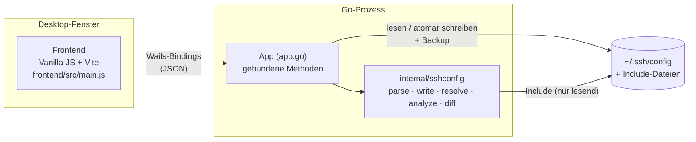

# Überblick

GoSSHpher ist ein grafischer Editor für OpenSSH-Client-Konfigurationen. Er bearbeitet die Datei, ohne die Formatierung zu verlieren, und zeigt für jeden Host, welche Werte ssh tatsächlich verwendet.

## Warum

Mit `~/.ssh/config` ist der Einstieg leicht, aber je größer die Datei wird, desto schwerer bleibt sie korrekt. Zwei Regeln von ssh machen größere Dateien fehleranfällig:

- **Der erste Wert gewinnt.** Für jede Option nimmt ssh den ersten Wert, den es beim Lesen der Datei von oben nach unten findet. Ein `Host *`-Block ganz oben überschreibt daher alle späteren Blöcke, und ein host-spezifischer Block unterhalb eines gemeinsamen Blocks greift unter Umständen nie.
- **Manche Optionen addieren sich.** `IdentityFile`, `CertificateFile`, `LocalForward`, `RemoteForward`, `DynamicForward`, `SendEnv` und `SetEnv` sammeln stattdessen die Werte aller passenden Blöcke.

Eine typische Konstellation kombiniert beides, z. B. ein Block für mehrere Aliase und darunter kleine Blöcke pro Alias:

```
Host github.com github-work github-private
  Hostname ssh.github.com
  Port 443
  User git

Host github-work
  IdentityFile ~/.ssh/work/ed25519

Host github-private
  IdentityFile ~/.ssh/private/ed25519
```

GoSSHpher macht diese Regeln sichtbar: Die App wertet die Datei aus wie ssh, zeigt, woher jeder Wert kommt, und warnt vor Optionen, die nie greifen.

## Funktionen

- **Verlustfreies Bearbeiten:** Kommentare, Leerzeilen, Einrückung (auch Tabs), `Key=Value`-Schreibweise, CRLF-Zeilenenden und der abschließende Zeilenumbruch bleiben erhalten. Unveränderte Zeilen werden byteweise zurückgeschrieben.
- **Globale Optionen:** Optionen vor dem ersten `Host` und `Host *`-Blöcke werden hervorgehoben, mit Hinweis, ob sie Vorrang haben (am Dateianfang) oder als überschreibbare Standardwerte wirken (am Dateiende).
- **Blöcke mit mehreren Aliasen und überlappende Blöcke**, umsortierbar per Drag & Drop, Buttons oder `Alt+↑/↓`.
- **Effektive Konfiguration** pro Host, ähnlich wie `ssh -G`, mit dem Quell-Block jedes Werts und den unterlegenen Werten. `Match` (`host`, `originalhost`, `user`, `localuser`, `all`, `final`, `tagged`) und `Include` werden ausgewertet.
- **Prüfungen:** überdeckte Optionen, doppelte Optionen im Block, unbekannte Keywords, Muster mit Großbuchstaben, fehlende Schlüsseldateien, `RemoteCommand … $SHELL` ohne `RequestTTY`, doppelte Gruppennamen.
- **Gruppen** (eine Ebene), gespeichert als Kommentar-Marker `# [Name] start` / `# [Name] end`. Angelegt und bearbeitet in einem Dialog mit Autovervollständigung; bevor Hosts zusammengeschoben werden, zeigt der Dialog, welche effektiven Werte sich ändern würden.
- **Templates** für Hosts und ganze Gruppen, mit Platzhaltern wie `{short}` oder `{ip}`, die beim Anwenden gefüllt oder abgefragt werden; pro Benutzer in `templates.json` gespeichert, nicht in der Config.
- **Sortierung** der Host-Liste nach Datei-Reihenfolge, Alias oder Hostname (nur Anzeige).
- **Veränderbare Breiten** der Bereiche und der Options-Spalte.
- **Textansicht** zum direkten Bearbeiten der Datei.
- **Sicheres Speichern:** einstellbares Backup beim ersten Speichern pro Sitzung (standardmäßig bleibt nur das neueste), atomares Schreiben, Dateirechte bleiben, Symlinks werden aufgelöst, Konfliktprüfung gegen externe Änderungen.
- **Oberfläche auf Englisch und Deutsch**, umschaltbar in den Einstellungen; weitere Sprachen sind je eine JSON-Datei.
- **Desktop-App** für Linux, macOS und Windows mit eigenem Icon; Linux-Menüeintrag über ein Installationsskript.

## Architektur im Überblick



Das Frontend hält das bearbeitete Dokument und schickt es nach jeder Änderung an Go. Go erzeugt den Text, prüft, ob er von der Datei auf der Platte abweicht, und führt die Prüfungen aus. Details: [Architektur](architecture.md).

## Kontext

- Modulname `gosshpher` ([go.mod](../../go.mod)); im Repository ist kein Remote eingerichtet.
- Lizenz: [Mozilla Public License 2.0](../../LICENSE). Die Autorenangaben stehen in [wails.json](../../wails.json).
- [config.example](../../config.example) enthält fiktive Hosts zum Ausprobieren. `config.template` und Backups (`config.*`) schließt die [.gitignore](../../.gitignore) aus, weil sie echte Serverdaten enthalten können.

[Index](index.md) · [English](../en/overview.md)
