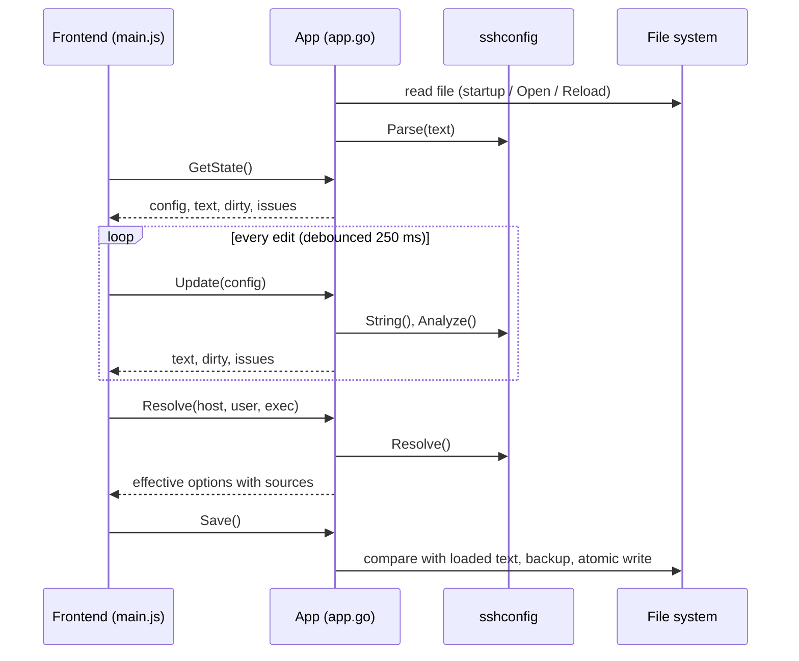

# Architecture

GoSSHpher is a [Wails v2](https://wails.io) application: a Go process that owns the file and all ssh logic, and a web frontend rendered by the system WebView. This document describes the components, the data flow and the rules for reading and writing the file.

## Components

| Part               | Path                                                                                                                 | Responsibility                                                                                                                                             |
| ------------------ | -------------------------------------------------------------------------------------------------------------------- | ---------------------------------------------------------------------------------------------------------------------------------------------------------- |
| Entry point        | [main.go](../../main.go)                                                                                             | Picks the file (first CLI argument or `~/.ssh/config`), embeds `frontend/dist` and the Linux window icon, starts the Wails window (1400×900, min. 900×600) |
| Bound API          | [app.go](../../app.go)                                                                                               | `App` struct whose exported methods are callable from JavaScript: load, update, parse text, resolve, preview changes, save, open/save dialogs              |
| Settings           | [settings.go](../../settings.go)                                                                                     | Settings file in the user's config directory: backup options and view settings                                                                             |
| External           | [external.go](../../external.go)                                                                                     | Included files, second window, running `Match exec` commands                                                                                               |
| Translations       | [internal/i18n/](../../internal/i18n/)                                                                               | Translation catalogs `locales/<language>.json` (embedded), lookup with English fallback                                                                    |
| Core library       | [internal/sshconfig/](../../internal/sshconfig/)                                                                     | Parser, writer, evaluation, checks, groups, effective-change diff, keyword list                                                                            |
| Frontend           | [frontend/index.html](../../frontend/index.html), [frontend/src/](../../frontend/src/) (ES modules, entry `main.js`) | Vanilla JavaScript UI, built with Vite 7                                                                                                                   |
| Generated bindings | [frontend/wailsjs/](../../frontend/wailsjs/)                                                                         | JS/TS wrappers for the `App` methods, generated by `wails build` / `wails generate module`                                                                 |
| Platform assets    | [build/](../../build/)                                                                                               | Icons, macOS `Info.plist`, Windows manifest/installer, Linux `.desktop` file                                                                               |

### Core library (`internal/sshconfig`)

| File                                                | Content                                                                                                                                |
| --------------------------------------------------- | -------------------------------------------------------------------------------------------------------------------------------------- |
| [model.go](../../internal/sshconfig/model.go)       | Data model: `Config` → `Block` (kind `global`, `host`, `match`) → `Entry` (`option`, `comment`, `blank`)                               |
| [parse.go](../../internal/sshconfig/parse.go)       | Splits the file into blocks, keeps every original line in `Raw`, splits arguments like ssh (quotes, trailing `#` comments)             |
| [write.go](../../internal/sshconfig/write.go)       | Renders the config; unchanged lines are emitted from `Raw`, changed lines in the indentation style of the block; inserts group markers |
| [group.go](../../internal/sshconfig/group.go)       | Group marker parsing (`# [Name] start/end`), name validation                                                                           |
| [match.go](../../internal/sshconfig/match.go)       | ssh wildcard matching (`*`, `?`), negation, comma lists for `Match`                                                                    |
| [resolve.go](../../internal/sshconfig/resolve.go)   | Evaluation like ssh: first value wins, cumulative keywords, `Match` (incl. assumed `exec` results), `Include`                          |
| [tokens.go](../../internal/sshconfig/tokens.go)     | %-tokens, `${ENV}` and `~` per keyword (TOKENS in `ssh_config(5)`)                                                                     |
| [analyze.go](../../internal/sshconfig/analyze.go)   | Checks that produce the hints shown in the UI                                                                                          |
| [diff.go](../../internal/sshconfig/diff.go)         | Compares the effective configuration of all literal aliases between two versions                                                       |
| [keywords.go](../../internal/sshconfig/keywords.go) | Keywords of `ssh_config(5)` with cumulative flag and typical values; deprecated aliases (descriptions are in the translation catalogs) |

## Data flow



- The **frontend owns the document while editing.** It mutates its copy of the config and sends the whole structure to `Update`. Go keeps the latest version, renders it and returns text, dirty flag and issues. The frontend does not replace its copy with the returned one, so focused inputs are not re-rendered while typing.
- **Dirty** means: rendered text ≠ text read from disk.
- The **text view** sends raw text to `ParseText`; the result replaces the frontend copy.
- **Effective configuration** (`Resolve`) and **change preview** (`PreviewChanges`) always run in Go on the latest synced document.

## Bound methods

| Method                                                                    | Purpose                                                                                 |
| ------------------------------------------------------------------------- | --------------------------------------------------------------------------------------- |
| `GetState()`                                                              | Current path, config, rendered text, dirty flag, issues                                 |
| `Update(cfg)`                                                             | Replace the document with the edited version                                            |
| `ParseText(text)`                                                         | Replace the document with parsed raw text (keeps CRLF if the file used it)              |
| `Resolve(host, user, exec)`                                               | Effective configuration for a host, optional `-l` user and assumed `Match exec` results |
| `IncludeFiles(value)` / `OpenWindow(path)`                                | Files of an `Include` line / open a file in a new window (second process)               |
| `RunMatchExec(host, user, command)`                                       | Run a `Match exec` command of that host in the user's shell (10 s limit)                |
| `PreviewChanges(cfg)`                                                     | Effective values that differ between the current document and `cfg`                     |
| `Keywords()`                                                              | Keyword list for autocompletion                                                         |
| `Languages()` / `Translations(lang)`                                      | Available UI languages / all texts of a language                                        |
| `NewID()`                                                                 | Random block id                                                                         |
| `Save()` / `SaveForce()` / `SaveAs()`                                     | Write the file (see below)                                                              |
| `Open()` / `Reload()`                                                     | Load another file / discard changes                                                     |
| `GetSettings()` / `SaveSettings(language, backup)` / `SaveUISettings(ui)` | Read the settings, store language and backup options, store view settings               |

## Reading and writing rules

### Round trip

- Every line is kept as `Raw`. When writing, a line is emitted unchanged if its parsed form still equals the structured fields (`Key`/`Value`, comment text, header patterns). Only edited lines are regenerated, using the indentation of the first option line of the block (default two spaces, none in the global block).
- Comments directly above a `Host`/`Match` line, together with the blank lines separating them from what comes before, belong to that block (`Leading`) and move with it. Comments further up, separated by a blank line, stay with the previous block; at the top of the file they form the file header (shown as *File header* in the host list).
- CRLF line endings and a missing final newline are preserved.
- Tests check that parsing and rendering returns identical bytes for the sample data, `config.example` and a local `config.template` if present.

### Groups

Groups are one level deep and stored as comments, which ssh ignores:

```
# [GitHub] start
Host github.com github-work github-private
  ...
# [GitHub] end
```

- When reading, the markers are removed from the comments and turned into `Block.Group`. The original marker lines and their positions (`GroupStartRaw`/`GroupStartPos`, `GroupEndRaw`/`GroupEndTrail`) are kept so hand-formatted markers round-trip exactly.
- When writing, a start marker is emitted where the group of a block differs from the previous block, an end marker where it differs from the next. New start markers go after the leading blank lines; new end markers directly after the last option.
- Marker syntax: `#`, optional spaces, `[Name]`, `start` or `end` (case-insensitive). End markers match their group case-insensitively.
- An end marker without an open group stays an ordinary comment. A group still open at the next start marker or at the end of the file is closed when writing.
- A group must be one contiguous run of blocks. The frontend keeps this invariant for all operations (see [Usage](usage.md#groups)).
- Group names must be non-empty, without `[`, `]` or line breaks, at most 80 characters, and unique (case-insensitive). Duplicates in hand-edited files produce a warning.

### Evaluation (`Resolve`)

- The host is lower-cased before matching (as ssh does). Host patterns match if at least one positive pattern matches and no negated pattern does.
- First value wins per keyword (aliases such as `PubkeyAcceptedKeyTypes` share the slot of their current name). Cumulative keywords collect values; repeated identical `IdentityFile`/`CertificateFile` values are ignored, like ssh does.
- `Match` criteria: `all`, `host`, `originalhost`, `user`, `localuser`, `tagged` are evaluated; `final` is assumed true; `canonical` is not simulated (false); `localnetwork`, `version`, `sessiontype`, `command` cannot be evaluated offline and count as not matching (noted in the result).
- `Match exec` is never run by the evaluation: the command is expanded with %-tokens and looked up in the assumptions passed by the UI (default: failing); `!exec` negates as in ssh. Like ssh, `exec` is skipped once an earlier criterion of the line failed. Every `exec` met is reported (`BlockResult.Execs`). `RunMatchExec` only runs commands that occur in the evaluation of the given host.
- `Include` is followed when its block matches: globs, `~/`, paths relative to the directory of the edited file, depth limit 16. Included files are read only.
- %-tokens: `Hostname` accepts `%h`; for keywords that accept tokens the resolution also returns the expanded values (`ResolvedOption.Expanded`) with `%C %d %h %i %j %k %L %l %n %p %r %u %%` (and `%T` for `LocalCommand`, only `%h %n %p %r` for `ProxyCommand`/`ProxyJump`), `${ENV}` and `~/` where ssh supports them. `%C` is the SHA-1 of `%l%h%p%r%j`. Tests compare `ControlPath`, `RemoteCommand` and `UserKnownHostsFile` with `ssh -G`.
- Key file checks expand tokens per literal alias of a `Host` block (`IdentityFile ~/.ssh/%h`).
- A test compares the result with `ssh -G` for every literal alias of the test data and `config.example`.

### Checks (`Analyze`)

Issues and evaluation notes are language-neutral: each has a code and parameters (e.g. `shadowed` with `key`, `value`, `hint` and one item per affected alias). The UI turns them into text with the catalog keys `issue.<code>` and `note.<code>`.

| Severity | Check                                                                                                                                                                                                                                                                                 |
| -------- | ------------------------------------------------------------------------------------------------------------------------------------------------------------------------------------------------------------------------------------------------------------------------------------- |
| error    | `Host`/`Match` without patterns/criteria, option without value, invalid group name                                                                                                                                                                                                    |
| warning  | Option shadowed for a literal alias by an earlier block (same value is ignored); option repeated in the same block; unknown keyword; pattern with upper-case letters; only negated patterns; `IdentityFile`/`CertificateFile` not found (`~` and `%d` expanded); duplicate group name |
| info     | Block with the same patterns as an earlier one; block without options; `RemoteCommand … $SHELL` without `RequestTTY yes/force`                                                                                                                                                        |

### Saving

1. Resolve symlinks and write to the target (dotfile repositories keep their links).
2. Compare the file on disk with the text read at load time; if it changed, `Save` returns `CONFLICT` and the UI offers to overwrite or reload.
3. If backups are enabled: on the first save of a file per session, copy the current file to `<file>.bak-YYYYMMDD-HHMMSS` and delete older backups of that file beyond the configured number (default one, i.e. only the newest backup; only files with exactly this name pattern are touched).
4. Write to a temporary file in the same directory, apply the original mode (default `0600`), rename over the target.

## Settings file

Settings are stored as JSON in the user's configuration directory (Go's `os.UserConfigDir`), in a folder named after the app id `de.netinventors.gosshpher` (constant `AppID` in [settings.go](../../settings.go)); the same id is the macOS bundle id and the Linux app id:

| Platform | Path                                                                                                                    |
| -------- | ----------------------------------------------------------------------------------------------------------------------- |
| Linux    | `$XDG_CONFIG_HOME/de.netinventors.gosshpher/settings.json`, default `~/.config/de.netinventors.gosshpher/settings.json` |
| macOS    | `~/Library/Application Support/de.netinventors.gosshpher/settings.json`                                                 |
| Windows  | `%AppData%\de.netinventors.gosshpher\settings.json`                                                                     |

```json
{
  "language": "en",
  "backup": { "enabled": true, "keep": 1 },
  "updateCheck": true,
  "ui": { "sort": "file", "collapsed": ["gitlab"], "widths": { "side": 300, "insp": 380, "key": 220 } }
}
```

| Key                  | Meaning                                                                              | Default         |
| -------------------- | ------------------------------------------------------------------------------------ | --------------- |
| `language`           | UI language (`en`, `de`); unknown values fall back to `en`                           | `en`            |
| `backup.enabled`     | Write a backup before overwriting a file                                             | `true`          |
| `backup.keep`        | Backups kept per file, `0` keeps all (max. 1000)                                     | `1`             |
| `terminal`           | Terminal program for *Connect in terminal*, the command is appended; empty = detect  | –               |
| `updateCheck`        | Ask GitHub for a newer release at start                                              | `true`          |
| `ui.sort`            | Host list sorting: `file`, `alias`, `hostname`                                       | `file`          |
| `ui.collapsed`       | Collapsed groups (lower-case names)                                                  | –               |
| `ui.widths`          | Widths of host list (`side`), inspector (`insp`) and option column (`key`) in pixels | 300 / 380 / 220 |
| `ui.dismissedUpdate` | Release whose update notice was dismissed                                            | –               |

- The file is created on the first change, with mode `0600` in a directory with mode `0700`, and written atomically. Missing keys fall back to the defaults.
- If the file exists but cannot be parsed, the defaults are used, the error is shown in the settings dialog, and view settings are not written back, so the file is never overwritten silently. Saving in the settings dialog replaces it.

[Index](index.md) · [Deutsch](../de/architecture.md)
