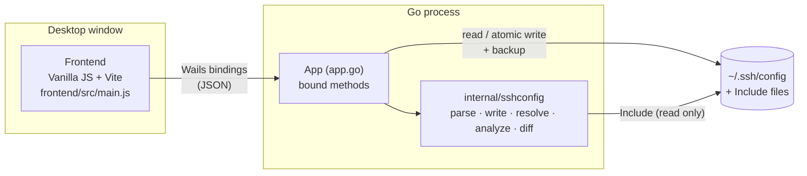

# Overview

GoSSHpher is a graphical editor for OpenSSH client configuration files. It edits the file without losing formatting and shows, for every host, which values ssh will actually use.

## Why

`~/.ssh/config` is easy to start with and hard to keep correct once it grows. Two rules of ssh make larger files error-prone:

- **First value wins.** For every option, ssh uses the first value it finds while reading the file top to bottom. A `Host *` block at the top therefore overrides every later block, and a host-specific block placed below a shared block may never take effect.
- **Some options add up.** `IdentityFile`, `CertificateFile`, `LocalForward`, `RemoteForward`, `DynamicForward`, `SendEnv` and `SetEnv` collect values from every matching block instead.

A typical constellation combines both, e.g. one block shared by several aliases and small per-alias blocks below it:

```
Host github.com github-work github-private
  Hostname ssh.github.com
  Port 443
  User git

Host github-work
  IdentityFile ~/.ssh/work/ed25519

Host github-private
  IdentityFile ~/.ssh/private/ed25519
```

GoSSHpher makes these rules visible: it evaluates the file the way ssh does, explains where every value comes from and warns about options that never take effect.

## Features

- **Lossless editing:** comments, blank lines, indentation (including tabs), `Key=Value` syntax, CRLF line endings and the final newline are preserved. Unchanged lines are written back byte for byte.
- **Global options:** options before the first `Host` and `Host *` blocks are highlighted, with a note whether they take precedence (top of file) or act as overridable defaults (end of file).
- **Blocks with several aliases and overlapping blocks**, reordered by drag and drop, buttons or `Alt+↑/↓`.
- **Effective configuration** per host, similar to `ssh -G`, including the source block of every value and the values that lost. `Match` (`host`, `originalhost`, `user`, `localuser`, `all`, `final`, `tagged`) and `Include` are evaluated.
- **Checks:** shadowed options, duplicate options in a block, unknown keywords, patterns with upper-case letters, missing key files, `RemoteCommand … $SHELL` without `RequestTTY`, duplicate group names.
- **Groups** (one level), stored as comment markers `# [Name] start` / `# [Name] end`. Created and edited in a dialog with host autocompletion; before hosts are moved together, the dialog shows which effective values would change.
- **Templates** for hosts and whole groups, with placeholders such as `{short}` or `{ip}` that are filled in or asked for when applying; stored per user in `templates.json`, not in the config.
- **Sorting** of the host list by file order, alias or hostname (display only).
- **Resizable panes** and option column.
- **Text view** for editing the raw file.
- **Safe saving:** configurable backup on the first save per session (only the newest one kept by default), atomic write, file mode kept, symlinks followed, conflict check against external changes.
- **UI in English and German**, switchable in the settings; further languages are one JSON file each.
- **Desktop app** for Linux, macOS and Windows with its own icon; Linux menu entry via an install script.

## Architecture at a glance



The frontend holds the document being edited and sends it to Go after every change. Go renders the text, decides whether it differs from the file on disk and runs the checks. Details: [Architecture](architecture.md).

## Context

- Module name `gosshpher` ([go.mod](../../go.mod)); the repository has no remote configured.
- Licensed under the [Mozilla Public License 2.0](../../LICENSE). Author information is set in [wails.json](../../wails.json).
- [config.example](../../config.example) contains fictitious hosts for trying the app. `config.template` and backups (`config.*`) are excluded by [.gitignore](../../.gitignore) because they may contain real server data.

[Index](index.md) · [Deutsch](../de/overview.md)
